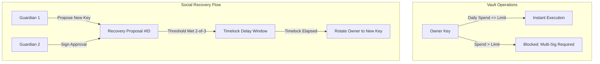

# Project : SorobanGuardian Vault

> **Smart Account Abstraction, M-of-N Social Recovery & Spending Policies on Stellar & Soroban**

[](https://stellar.org/soroban)
[](https://stellar.org)
[](https://stellar.org)
[](https://react.dev)

---

## 1. Problem Statement & Research
In standard Web3 wallets, losing a single private key means permanent loss of assets.
Traditional multi-sig contracts (such as classic Gnosis-style contracts) introduce tremendous friction:
- Every tiny transaction requires collecting multiple signatures from cold hardware wallets or peers, making everyday payments unusable.
- Conversely, single-key wallets lack emergency recovery if the device is lost, stolen, or compromised.

## 2. The Innovation ("A Bit Different")
**SorobanGuardian Vault** bridges the gap between usability and military-grade security using Soroban's native account abstraction capabilities:
- **Velocity Spending Limit**: The primary owner can instantly execute daily transactions up to a set velocity quota (e.g. 1,500 XLM/day) without collecting guardian signatures.
- **M-of-N Social Recovery Quorum**: If the owner loses access or key is compromised, designated Guardians (trusted peers, hardware backups, institutional cosigners) can initiate and vote on a recovery proposal.
- **Security Timelock Delay**: When threshold approvals are achieved, an enforced timelock window prevents instant malicious takeovers, allowing the legitimate account owner to cancel rogue recoveries.

---

## 3. Architecture



---

## 4. Smart Contract Details (`contracts/soroban_guardian`)
- **Functions**:
  - `init_vault(owner, guardians, threshold, daily_limit, timelock_delay, initial_balance)`
  - `spend(caller, recipient, amount)`
  - `propose_recovery(proposer, new_owner)`
  - `approve_recovery(guardian, proposal_id)`
  - `execute_recovery(proposal_id)`
  - `get_vault_info()` / `get_proposals()`

### Running Unit Tests
```bash
cd contracts
cargo test
```

### Compiling to WebAssembly (Wasm)
```bash
cargo build --target wasm32v1-none --release
```

---

## 5. Web3 Governance Dashboard (`frontend/`)
- Built with **React 18**, **TypeScript**, **Vite**, **Tailwind CSS**, and **Lucide Icons**.
- Interactive **Velocity Spend Desk** with dynamic quota consumption meters.
- Turnkey **Social Recovery Console** allowing simulation of Guardian votes, threshold checks, and key rotation.
- Real-time audit logs of on-chain Soroban events.

### Running Frontend
```bash
cd frontend
npm install
npm run dev
```

### Building for Production
```bash
npm run build
```
